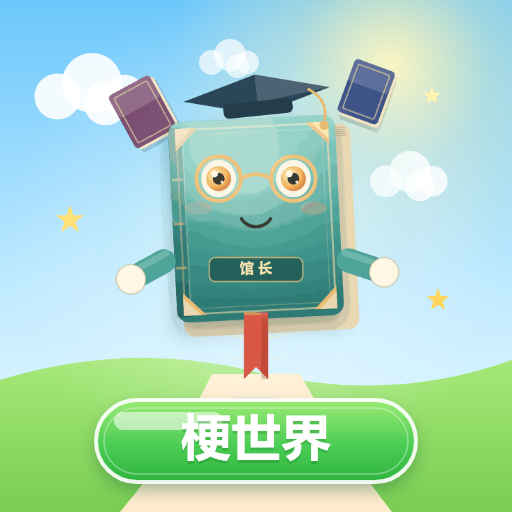

# 《梗世界》小游戏介绍

「梗世界」是一款校园梗知识生存答题小游戏。你意外穿越到一个靠梗说话的世界：接住梗才能活下去，接不住的人会被淘汰。从宿舍、食堂、教室到图书馆，四章剧情、四位对手轮番出题，每章都有专属题池与开场对白；通关后按顺序解锁下一章，在校园地图上点亮四座建筑。每局 10 题、3 条命，答错扣命，第 10 题 BOSS 压轴、双倍得分；答对可收录梗图鉴、赚梗币、换 6 款皮肤、冲排行榜。150 道热梗题、四大题型，配合提示、加时、复活与双倍奖励，帮你一路接梗。一局只要 3～5 分钟。接不住梗，就出局——你能活着找到回去的路吗？

---

## 小游戏图标

- 512×512（上传/商店用）：`docs/branding/app-icon-512.png`
- 144×144（列表/小尺寸预览）：`docs/branding/app-icon-144.png`
- 重新生成：`node tools/art/make-app-icon.mjs`

